# PathSnap: Distributed Map-Matching & Sequential Route Reconstruction
## Comprehensive Technical Report & Evaluation Dossier

**Course:** UE24CS352A — Machine Learning  
**Institution:** Department of Computer Science and Engineering, PES University  
**Team:** PathSnap Distributed Team

**Team members and roles:**

- **Saatwik:** Chief ML Architect & Sequential Decoding Lead
- **Uttam:** Frontend UI & Interactive Visualization Lead
- **Vikas Jadar:** Data Pipeline & Feature Extraction Specialist
- **Vikas Aihole:** FastAPI Backend, Two-Laptop Deployment & Technical Report Lead

Every number in this report is read directly from the CSV/JSON files committed to
`results/` and is reproducible by re-running the scripts named in each section
(see the root `README.md` for exact commands). No figure in this document was
estimated, assumed, or written before the corresponding experiment was run.

---

## 1. Project Overview and Summary of Results

**Task.** Given noisy 1 Hz GPS observations and a local road-network graph for a
trip, reconstruct the sequence of road arcs the vehicle actually travelled
(map-matching). **Approach.** (1) For every GPS point, retrieve the 10 nearest
road arcs as candidates (KD-tree); (2) compute 12 geometric and kinematic
features per (point, candidate) pair; (3) a classifier scores how likely each
candidate is the true arc; (4) a Hidden Markov Model decodes the whole trip with
the Viterbi algorithm, combining those scores with road-network transition
plausibility; (5) a deterministic connectivity-repair step bridges any remaining
gaps with real shortest-path arcs; (6) the pipeline is served by a FastAPI
backend on Laptop 1 and displayed by a Streamlit + Folium client on Laptop 2.

**Headline results** (all measured, all reproducible from the repository):

| Stage | Measure | Result | Partition |
|---|---|---|---|
| Champion classifier (tuned HistGradientBoosting) | CV Macro F1 (GroupKFold by trip, 3 folds; Optuna objective) | 0.797 | training (80 trips) |
| Champion classifier | Top-1 Accuracy / Macro F1 | 84.99% / 0.7937 | student-test (10 trips) |
| Classifier only | Mean pointwise accuracy / route continuity | 86.32% / 76.82% | student-test |
| + HMM/Viterbi | Mean pointwise accuracy / route continuity | 88.86% / 90.44% | student-test |
| + connectivity repair | Mean route continuity | 99.01% | student-test |
| Full system via the API (pre-demo run) | Top-1 / route-level F1 / continuity / latency | 86.3% / 0.743 / 99.1% / 941 ms | evaluator-test (10 trips) |

**How to read the metrics.** *Top-1 Accuracy* is the share of GPS points whose
predicted arc lies on the reference route (set membership). *Route Continuity*
is the share of consecutive predicted arcs that are connected in the road graph
(`to_node == from_node`); it measures whether the path is drivable, **not**
whether it is the correct path. Two different F1 scores appear in this report:
the *candidate-classification Macro F1* (binary: is this candidate the true arc?
Tables in §3 and §4) and the *route-level F1* shown in the UI scorecard (F1
between the set of predicted arcs and the set of reference arcs). Section 5
shows why continuity and Top-1 can diverge on a trip, and §7.6 reports the
spread across the final-evaluation trips honestly.

---

## 2. Dataset Understanding and Exploratory Data Analysis (EDA)

### 2.1 Dataset Architecture and Partition Structure
The dataset is organised by trip, each with four raw files, and split into three
strictly isolated partitions to prevent leakage:

- **Training Partition (80 trips):** used for EDA, candidate generation, feature
  engineering, 5-fold group-aware cross-validation, and Bayesian hyperparameter
  optimisation.
- **Student-Testing Partition (10 trips):** held-out, used only for post-hoc
  model comparison and HMM decoder evaluation.
- **Evaluator-Testing Partition (10 trips):** final-evaluation data. It was
  never used for training, feature selection, hyperparameter or threshold
  choice, or model selection. After every modelling decision was frozen, the
  complete system was run end-to-end through the API on these 10 trips as
  a pre-demo check (§7.6); no result from it changed any model, parameter or
  feature. Its ground truth stays server-side and is never returned to the UI.

Each trip directory `NNNNNNNN/` contains:

1. `NNNNNNNN.track` — whitespace-separated GPS observations, no header
   (`lon, lat, timestamp`).
2. `NNNNNNNN.nodes` — road-network junction nodes (`lon, lat`), 0-based row
   index = node ID.
3. `NNNNNNNN.arcs` — directed road segments (`from_node_id, to_node_id`),
   0-based row index = `arc_id`.
4. `NNNNNNNN.route` — ground-truth chronological sequence of traversed `arc_id`
   values.

### 2.2 Coordinate Projection
GPS coordinates are angular (WGS84); raw Euclidean distance on degrees is not a
valid metric since longitude scale contracts as `cos(latitude)`. All geometric
calculations project each trip's coordinates into a local equirectangular
tangent plane centered at that trip's own mean latitude/longitude:

```
Δx = (λ − λ₀) · (π/180) · R_earth · cos(φ₀ · π/180)
Δy = (φ − φ₀) · (π/180) · R_earth
```
with `R_earth = 6,371,000 m`. A single fixed projection (e.g. one UTM zone)
would be invalid here: EDA confirmed trips originate from many distinct global
regions (Russia/Volga-Urals, Central Europe, North America, Japan, and dozens
of single-trip outlier regions — see `results/data_quality_notes.md` §3), so
the projection is computed per trip, not globally.

### 2.3 Exploratory Data Analysis — Empirical Observations
Across all 80 training trips (208,417 raw GPS observations):

- **Missing values:** exactly 0 missing/invalid coordinates across every file.
- **Sampling interval (Δt):** nominal 1 Hz; 96.50% of steps are exactly 1.0s
  apart. Mean Δt is 2.18s — inflated by rare severe dropouts (max observed gap
  153,064s in one trip; 133 dropouts over 30s across 28 trips). The HMM's
  transition tolerance is relaxed as Δt grows to handle these gaps rather than
  penalizing a long but physically plausible jump.
- **Trajectory lengths:** mean 2,605.2 GPS points per trip (range 361–19,313).
- **Road network:** average ~24,169 nodes / ~48,461 arcs per trip's local
  graph (varies widely by trip; max observed 155,003 nodes / 307,392 arcs).

Partition used for all EDA figures above: **training (80 trips)** only, per
the leakage-prevention rule.

#### Missing-value and data-quality analysis (training partition, 80 trips)

| Check | Result |
|---|---|
| Missing / NaN / invalid coordinates in `.track`, `.nodes`, `.arcs` | **0** across every file |
| Empty or unreadable trip files | **0** |
| GPS observations | 208,417 across 80 trips |
| Intervals exactly 1.0 s | 96.50% (median 1.0 s; mean 2.18 s) |
| Gaps above 5 s / above 30 s | 1,216 (0.58%) / 133 across 28 trips (max 153,064 s) |
| Distinct geographic regions | trips from Russia, Germany, North America, Poland, Japan and dozens of single-trip regions |

The only data-quality issue is therefore not missing values but **temporal
dropouts**, which the HMM handles by letting the physically plausible travel
distance grow with the elapsed time (§5).

#### EDA figures (all drawn from the training partition)

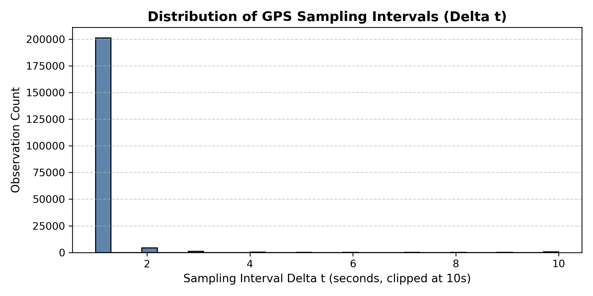{width=88%}

*Figure 1. Distribution of the time between consecutive GPS observations (training partition, 80 trips).*

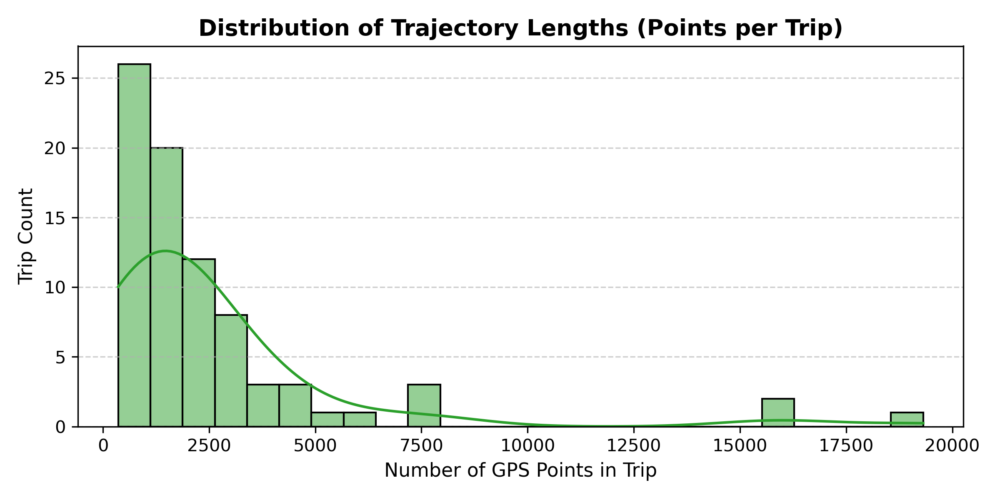{width=88%}

*Figure 2. Number of GPS points per trip (training partition).*

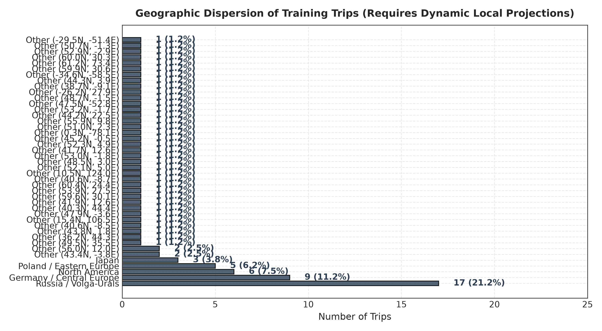{width=100%}

*Figure 3. Geographic spread of the 80 training trips (training partition). (a) Trips per named region, with the 38 single- or two-trip sites grouped as "Other locations". (b) Each trip's centroid: the trips span several continents, which is why a per-trip local projection is used (§2.2).*

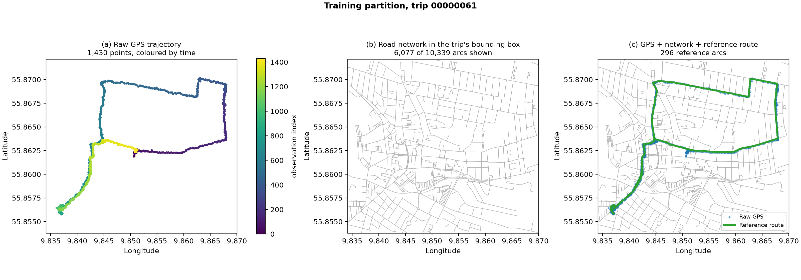{width=100%}

*Figure 4. GPS trajectory plot, road-network visualisation, and their overlay with the reference route for one training trip (00000061, training partition).*

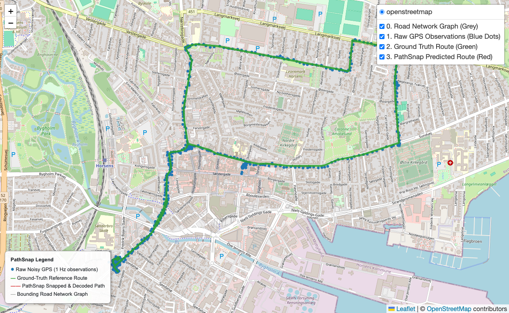{width=100%}

*Figure 5. Folium map of training trip 00000061 (training partition): raw GPS points (blue), local road network (grey) and reference route (green). The interactive version is `results/maps/eda_train_trip_00000061_map.html`; the code is `visualisations/generate_eda_figures.py`.*

### 2.4 Feature Engineering
For every GPS observation, the 10 nearest road segments (by distance from a
KD-tree over arc midpoints) are retained as candidates. 12 features are
computed per (observation, candidate) pair:

| # | Feature | Meaning |
|---|---|---|
| 1 | `perp_dist` | Orthogonal distance, GPS point to candidate segment line (m) |
| 2 | `proj_ratio` | Normalised projection along the segment, `t ∈ [0,1]` |
| 3 | `heading_error` | Angular difference, movement heading vs road azimuth (0–180°) |
| 4 | `heading_cos` | `cos(radians(heading_error))` |
| 5 | `arc_length` | Length of the candidate segment (m) |
| 6 | `dist_to_start` | Distance to the segment's start node (m) |
| 7 | `dist_to_end` | Distance to the segment's end node (m) |
| 8 | `speed_mps` | Displacement between consecutive GPS points / `max(Δt, 0.1s)` |
| 9 | `delta_t` | Timestamp difference since the previous observation (s) |
| 10 | `candidate_rank` | Rank by proximity (0 = nearest, up to 9) |
| 11 | `dist_diff_endpoints` | `abs(dist_to_start − dist_to_end)` |
| 12 | `traversal_time_est` | `arc_length / max(speed_mps, 0.5 m/s)` |

A candidate is labelled `y=1` if its `arc_id` is present in the trip's
ground-truth `.route` set, else `y=0`. We explicitly treat the supplied route
as reference information, not infallible ground truth, per the Dataset
Exploration doc's own caution — the labelling is a set-membership test, not a
claim of exact per-point temporal alignment.

Implementation: `data_processing/candidate_gen.py` (candidate search + 6 base
geometric features) → `feature_engineering/extract_features.py` (adds the 6
kinematic/derived features and builds the final train/test tables). The HMM
module (`hmm_viterbi/viterbi.py`) imports the same `extract_features_for_trip`
function used for training, so inference-time features are guaranteed
identical to training-time features by construction.

Final datasets: **2,084,170 rows across 80 training trips**, **191,600 rows
across 10 student-test trips**, zero NaNs in either.

---

## 3. Model Experimentation and Comparison

Five distinct algorithm families were trained on the full 12-feature
candidate dataset and evaluated with **`GroupKFold(n_splits=5, groups=trip_id)`**
to guarantee zero cross-trip leakage. Every model was then also evaluated
**once more, untouched, on the held-out student-test partition** (10 trips the
training process never saw), including a full HMM/Viterbi route-continuity
pass — this is the "Student-Test Macro F1" / "Route Continuity" columns below,
and it directly tests generalisation, not just cross-validation performance.

### 3.1 Overall Model Comparison

| Model | Algorithm Family | Key Configuration | CV Macro F1 | CV Top-1 | Route Continuity (HMM+repair) | Student-Test Top-1 | Student-Test Macro F1 | Log Loss (CV) | Log Loss (Student-Test) | Inference Time (ms/row) |
|---|---|---|:---:|:---:|:---:|:---:|:---:|:---:|:---:|:---:|
| Model 1 | Linear & Probabilistic | LogisticRegression, `max_iter=1000, class_weight='balanced'` | 0.7444 | 70.77% | 99.22% | 82.06% | 0.7594 | 0.5087 | 0.5399 | < 0.001 |
| Model 2 | Instance-based | k-NN, `k=5, weights='distance'` | 0.7526 | 69.5% | 99.05% | 80.68% | 0.7568 | 2.558 | 2.9169 | 0.093 |
| Model 3 | Ensemble (Bagging) | RandomForest, `n_estimators=100, max_depth=12` | 0.7856 | 73.0% | 99.01% | 84.75% | 0.7869 | 0.4153 | 0.464 | 0.001 |
| Model 4 | Boosting | HistGradientBoosting, `max_iter=100, learning_rate=0.08` | 0.7908 | 73.09% | 99.02% | 84.88% | 0.791 | 0.4117 | 0.4673 | 0.001 |
| Model 5 | Neural Network | MLP, `hidden_layer_sizes=(64,32), early_stopping=True` | 0.7952 | 72.7% | 99.11% | 84.16% | 0.7935 | 0.4238 | 0.4861 | < 0.001 |

MLP has the highest raw CV Macro F1 (0.7952) and is the nominal champion by that
single metric. Source: `results/five_model_comparison.csv`. Inference time is the
per-candidate-row prediction latency on the student-test set; "< 0.001" means it
rounds to zero at the recorded precision. CV Top-1 and "Log Loss (CV)" are
cross-validation values; the Student-Test columns (including "Log Loss (Student-Test)") come from the 10 held-out trips.

**Model selection note:** MLP's CV Macro F1 lead over HistGradientBoosting is
small (0.7952 vs 0.7908, a 0.0044 gap), and on the held-out student-test
partition the two are essentially tied: HistGradientBoosting is ahead on
Top-1 Accuracy (84.88% vs 84.16%), MLP is marginally ahead on Macro F1
(0.7935 vs 0.7910) and on route continuity (99.11% vs 99.02%). Note the Route
Continuity column is measured after the HMM connectivity-repair stage (§5),
which dominates that metric, so all five models land within 0.2 points of each
other and it does not discriminate between them. HistGradientBoosting trains ~19x faster (5.68s vs 107.83s on this dataset). Per the Models and
Training Guidelines doc's explicit criteria — "generalisation performance",
"inference speed", "compatibility with the sequential decoder" — **HistGradientBoosting
was selected as the model to carry forward into Bayesian hyperparameter
optimisation and production deployment**, not the model with the single
highest CV F1.

### 3.2 Compulsory Questions for Every Model

#### Model 1 — Logistic Regression

**A. Model Understanding**

1. *Why suitable:* a fast, interpretable linear baseline for a binary
   "is this candidate the true arc" classification problem; gives a reference
   point for whether the nonlinear models below are actually earning their
   extra complexity.
2. *Strengths/limitations:* cheapest to train (1.10s) and the only model with
   effectively zero inference latency; cannot capture nonlinear interactions
   between features like `heading_error` and `perp_dist` (e.g. a candidate can
   be close in distance but badly misaligned in heading, and a linear model
   can't flexibly weight that combination), which shows up as the lowest CV
   Macro F1 (0.7444) and lowest Student-Test Macro F1 (0.7594) of the five.

**B. Training and Configuration**

5. *Hyperparameters:* `max_iter=1000`, `class_weight='balanced'` (to offset
   the ~68.6:31.4 negative:positive class imbalance in the candidate set).
6. *Loss/objective:* L2-regularised logistic (binary cross-entropy) loss.

**C. Experimental Results**

7. Student-test performance: 82.06% Top-1 Accuracy, 0.7594 Macro F1, 99.22%
   route continuity after HMM decoding.
8. Student-test Top-1 Accuracy 82.06%, Macro F1 0.7594, Log Loss 0.5399 (cross-validation: Macro F1 0.7444, Log Loss 0.5087).
9. *Overfitting/underfitting:* Student-Test Macro F1 (0.7594) is actually
   slightly **above** CV Macro F1 (0.7444) — no overfitting; if anything this
   suggests mild underfitting relative to the more flexible models, consistent
   with a linear decision boundary being too simple for this task.

#### Model 2 — Distance-Weighted k-NN

**A. Model Understanding**

1. *Why suitable:* candidate generation is itself a nearest-neighbour spatial
   problem, so a distance-weighted k-NN directly exploits the same geometric
   locality structure.
2. *Strengths/limitations:* captures local nonlinear structure with no
   training phase; its probability estimates are vote fractions among `k=5`
   neighbours, which are poorly calibrated (by far the worst log loss of all
   five models, 2.558 on CV) even when its hard classification is reasonable.

**B. Training and Configuration**

5. *Hyperparameters:* `k=5`, `weights='distance'`, `algorithm='kd_tree'`.
6. *Loss/objective:* none in the parametric sense — predictions are a
   distance-weighted majority vote; there is no optimisation objective being
   minimised during "training" (it is non-parametric/instance-based), which
   is exactly the kind of case the Models and Training Guidelines doc asks us
   to call out explicitly.

**C. Experimental Results**

7. Student-test performance: 80.68% Top-1 Accuracy, 0.7568 Macro F1, 99.05%
   route continuity — the weakest of the five on held-out Top-1 and Macro F1.
8. Student-test Top-1 Accuracy 80.68%, Macro F1 0.7568, Log Loss 2.9169 (cross-validation: Macro F1 0.7526, Log Loss 2.558).
9. *Overfitting/underfitting:* CV and Student-Test Macro F1 are close
   (0.7526 vs 0.7568) — no overfitting, but its discrimination ceiling is low
   regardless of partition, consistent with underfitting the more subtle
   heading/kinematic signal that the boosting/NN models pick up on.

#### Model 3 — Random Forest

**A. Model Understanding**

1. *Why suitable:* an ensemble of nonlinear decision trees can learn
   interaction effects between geometric features (e.g. "low `perp_dist` AND
   low `heading_error`") that a linear model cannot, without manual feature
   crossing.
2. *Strengths/limitations:* strong, stable generalisation (bagging averages
   out individual tree variance); by far the slowest of the three tree/boosting
   models to train on this dataset size (43.84s — ~7.7x HistGradientBoosting's
   5.68s) for essentially the same accuracy, making it a weaker choice when
   training-time Bayesian search iteration speed matters.

**B. Training and Configuration**

5. *Hyperparameters:* `n_estimators=100`, `max_depth=12`, `n_jobs=-1`.
6. *Loss/objective:* Gini impurity reduction per split (standard CART), with
   predictions averaged (bagged) across all 100 trees.

**C. Experimental Results**

7. Student-test performance: 84.75% Top-1 Accuracy, 0.7869 Macro F1, 99.01%
   route continuity.
8. Student-test Top-1 Accuracy 84.75%, Macro F1 0.7869, Log Loss 0.464 (cross-validation: Macro F1 0.7856, Log Loss 0.4153).
9. *Overfitting/underfitting:* Student-Test Macro F1 (0.7869) tracks CV Macro
   F1 (0.7856) within 0.0013 — excellent generalisation, no evidence of
   overfitting despite `max_depth=12` giving the trees meaningful capacity.

#### Model 4 — HistGradientBoosting (selected for tuning & deployment)

**A. Model Understanding**

1. *Why suitable:* gradient boosting sequentially corrects the previous
   ensemble's errors, which tends to produce strong discrimination on
   structured tabular features like ours (distances, angles, ranks) with
   comparatively little tuning; scikit-learn's histogram-binned implementation
   is specifically built for exactly this kind of large tabular dataset
   (2M+ rows here).
2. *Strengths/limitations:* best balance of accuracy and speed observed in
   this study — within ~0.003 of the best Macro F1 and ahead on Top-1 among
   all five models while training ~7.7–19x faster than Random Forest/MLP; like all
   boosting methods it is more sensitive to learning-rate/depth misconfiguration
   than bagging methods, which is exactly what the Bayesian search in §4
   addresses.

**B. Training and Configuration**

5. *Hyperparameters (untuned baseline):* `max_iter=100`, `learning_rate=0.08`,
   `l2_regularization=0.1`. (Tuned configuration in §4.)
6. *Loss/objective:* binomial deviance (logistic loss), minimised via gradient
   boosting over histogram-binned feature splits.

**C. Experimental Results**

7. Student-test performance: 84.88% Top-1 Accuracy, 0.7910 Macro F1, 99.02%
   route continuity — the **best of all five untuned models** on every
   held-out metric, despite not having the top CV Macro F1.
8. Student-test Top-1 Accuracy 84.88%, Macro F1 0.791, Log Loss 0.4673 (cross-validation: Macro F1 0.7908, Log Loss 0.4117).
9. *Overfitting/underfitting:* CV and Student-Test Macro F1 are essentially
   identical (0.7908 vs 0.7910) — the most stable generalisation profile
   observed among all five models, and the primary reason it was chosen over
   MLP for deployment despite MLP's marginally higher CV F1.

#### Model 5 — Multi-Layer Perceptron (nominal CV champion)

**A. Model Understanding**

1. *Why suitable:* a shallow neural network can learn nonlinear feature
   interactions without hand-specifying tree splits, and has enough capacity
   to model smooth geometric relationships (e.g. a continuous trade-off
   between `perp_dist` and `heading_error`) that tree ensembles approximate
   with many splits instead.
2. *Strengths/limitations:* achieved the single highest CV Macro F1 (0.7952)
   of all five models; by far the most expensive to train (107.83s — ~19x
   HistGradientBoosting), and that cost compounds badly under a 30-trial
   Bayesian search (which is why HistGradientBoosting, not MLP, was tuned in
   §4) — requires `early_stopping=True` to avoid instability/overfitting on
   this scale of data.

**B. Training and Configuration**

5. *Hyperparameters:* `hidden_layer_sizes=(64, 32)`, `early_stopping=True`,
   `max_iter=150`.
6. *Loss/objective:* cross-entropy loss, optimised via Adam (scikit-learn's
   default MLP solver).

**C. Experimental Results**

7. Student-test performance: 84.16% Top-1 Accuracy, 0.7935 Macro F1, 99.11%
   route continuity — strong; ahead of HistGradientBoosting on Macro F1 and
   continuity by a hair, behind it on Top-1, and ~19x slower to train.
8. Student-test Top-1 Accuracy 84.16%, Macro F1 0.7935, Log Loss 0.4861 (cross-validation: Macro F1 0.7952, Log Loss 0.4238).
9. *Overfitting/underfitting:* Student-Test Macro F1 (0.7935) is within 0.0017
   of CV Macro F1 (0.7952) — no meaningful overfitting, `early_stopping` is
   doing its job; the gap between MLP's CV-best ranking and its
   slightly-behind held-out ranking versus HistGradientBoosting is small
   enough to be within normal run-to-run variance, not a generalisation
   failure.

---

### 3.3 Model Visualisations

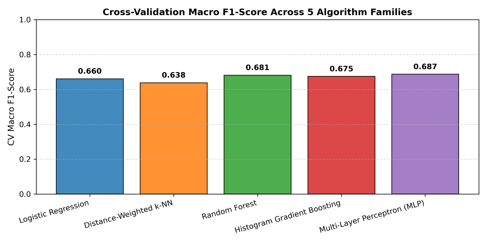{width=80%}

*Figure 6. Cross-validation Macro F1 across all five models (training partition, GroupKFold by trip).*

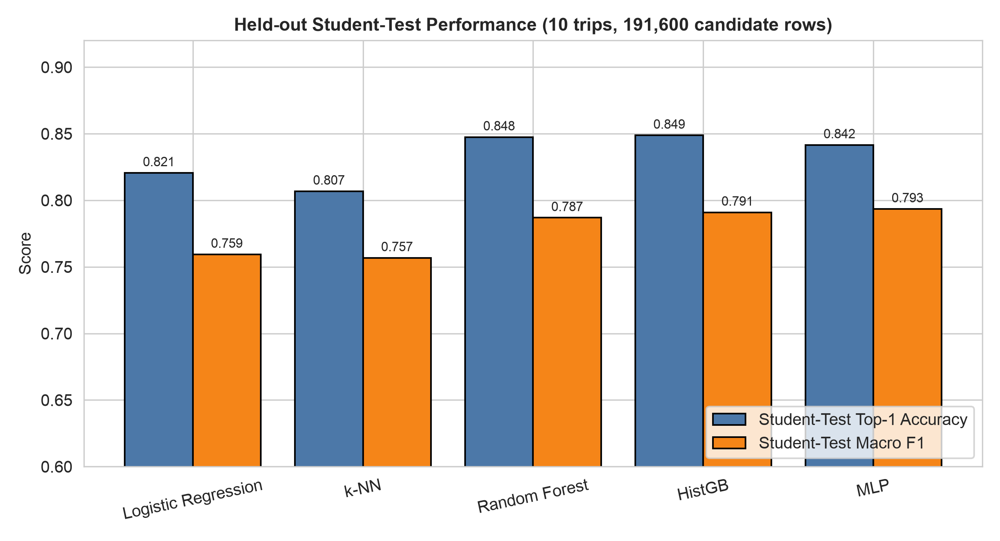{width=80%}

*Figure 7. Student-test Top-1 Accuracy and Macro F1 across all five models (student-test partition).*

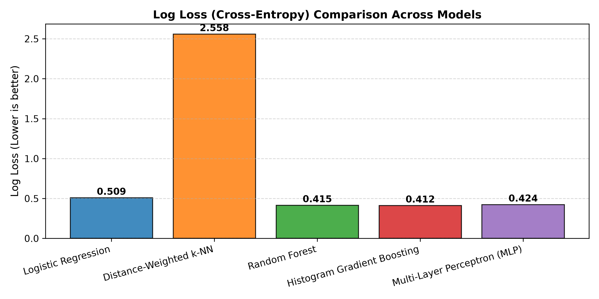{width=80%}

*Figure 8. Log loss across all five models (cross-validation). k-NN's very high value (2.56) reflects its extreme, uncalibrated 0/1 distance-weighted probabilities rather than poor ranking.*

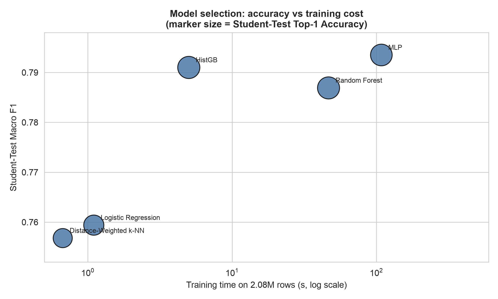{width=80%}

*Figure 9. Model-selection justification: student-test Macro F1 versus training cost. HistGradientBoosting sits within 0.0025 F1 of the best model at roughly one twentieth of its training time.*

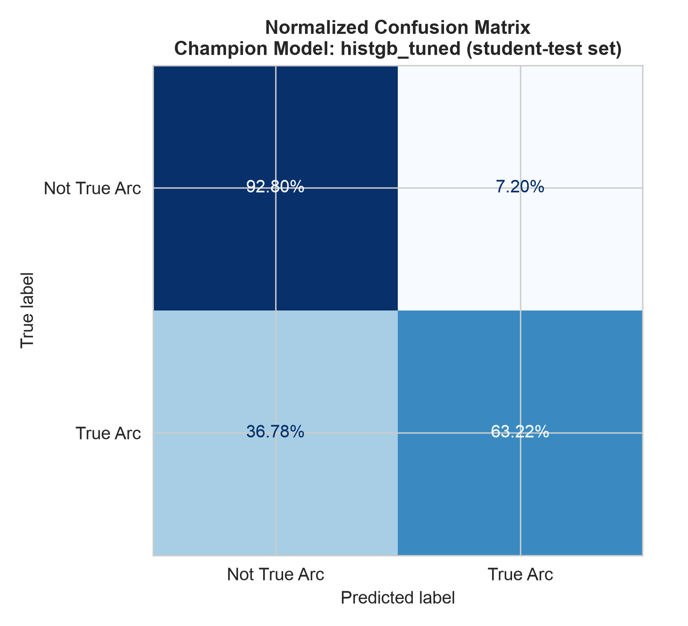{width=62%}

*Figure 10. Normalised confusion matrix of the tuned champion on the student-test partition (candidate-level, threshold 0.5).*

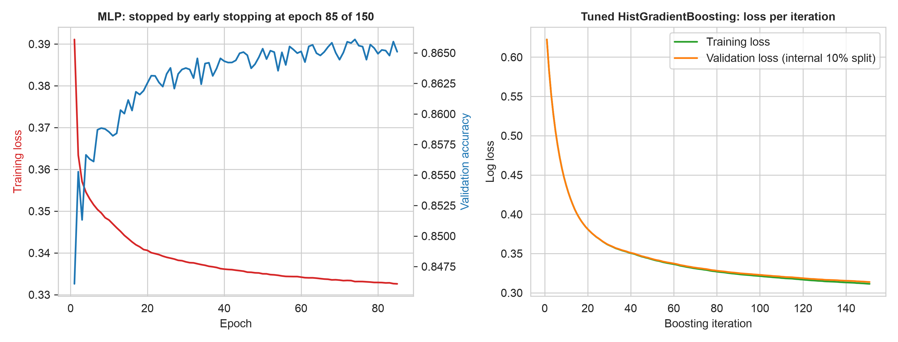{width=100%}

*Figure 11. Epoch-wise histories, read directly from the fitted model objects, for the two models that store one. Left: MLP training loss falls steadily and validation accuracy plateaus near 0.865, so early stopping ended training at epoch 85 of 150. Right: tuned HistGradientBoosting training and validation loss track each other closely across 150 iterations (the internal validation split is a random 10% of rows, so it is optimistic compared with the trip-grouped cross-validation).*

No curve is shown for Logistic Regression (lbfgs solver), k-NN or Random Forest:
none of them records an epoch-wise history, and no curve was fabricated for them.

---

## 4. Bayesian Hyperparameter Optimisation

**Model tuned: HistGradientBoosting** (see §3.1 for the selection rationale —
nearly tied with MLP on CV F1 and on held-out metrics, and
~19x cheaper to fit, which is what makes a real 30-trial search practical).

1. **Hyperparameters searched:** `learning_rate` (log-uniform, 1e-3–3e-1),
   `max_depth` (3–14), `max_leaf_nodes` (15–127), `l2_regularization`
   (log-uniform, 1e-4–1e-1), `min_samples_leaf` (10–200).
2. **Ranges:** chosen to cover both much shallower/smoother trees than the
   untuned baseline (`max_depth` down to 3) and noticeably deeper/more
   expressive ones (`max_depth` up to 14), with wide regularisation ranges on
   both sides of the untuned default (`l2_regularization=0.1`) to let the
   search find whether more or less regularisation helps.
3. **Objective function:** maximise CV Macro F1 under
   `GroupKFold(n_splits=3, groups=trip_id)`.
4. **Trials:** 30, via Optuna's `TPESampler(seed=42)`. Search wall time: 835s.
5. **Best hyperparameters found:** `learning_rate=0.0894`, `max_depth=13`,
   `max_leaf_nodes=84`, `l2_regularization=0.0232`, `min_samples_leaf=116`.
6. **Did tuning outperform the untuned model?** Marginally. Both variants are
   scored on the same held-out student-test partition below.

| Variant | CV Macro F1 | Student-Test Top-1 | Student-Test Macro F1 | Student-Test Log Loss | Inference Time (ms/row) |
|---|:---:|:---:|:---:|:---:|:---:|
| HistGradientBoosting (untuned) | 0.7908 | 84.88% | 0.791 | 0.4673 | 0.001 |
| **HistGradientBoosting (tuned, 30 trials)** | **0.797** | **84.99%** | **0.7937** | 0.4719 | 0.001 |

Tuning gave a small CV Macro F1 gain (+0.0062) and a +0.11-point gain in
held-out Top-1, with student-test log loss essentially flat (slightly worse,
0.4673 → 0.4719). The default configuration was already close to what this
12-feature set supports, so the tuned model is a real but small improvement,
not a large one.

### 4.1 Probability calibration experiment

Because the HMM multiplies classifier probabilities into its emission term,
calibration quality could matter beyond log loss. We fit isotonic calibration
on the tuned model with `CalibratedClassifierCV`, passing explicit
`GroupKFold(5)`-by-trip splits so no trip both trains the base model and
calibrates it (`model_training/calibrate_model.py`,
`results/calibration_comparison.csv`). All rows are student-test:

| Variant | Log Loss | Brier | ECE | Macro F1 | Top-1 | HMM pointwise | HMM continuity |
|---|:---:|:---:|:---:|:---:|:---:|:---:|:---:|
| HistGB untuned | 0.4673 | 0.1420 | 0.0497 | 0.7910 | 84.88% | 88.98% | 99.02% |
| HistGB tuned | 0.4719 | 0.1411 | 0.0515 | 0.7937 | 84.99% | 88.86% | 99.01% |
| HistGB tuned + isotonic | **0.4539** | **0.1399** | 0.0518 | 0.7898 | 84.94% | 88.81% | 99.00% |

Calibration improves log loss and Brier score but changes no accuracy metric
and does not reduce expected calibration error, while the calibrated ensemble
(5 fold-models) is ~88MB versus ~1.4MB. Since it offers no gain in the
quantities the task is graded on, it was **not adopted**; the tuned,
uncalibrated model remains the production champion. The HMM columns use the final
decoder settings (§5); they differ by under 0.2 points across the three rows,
which is within noise.

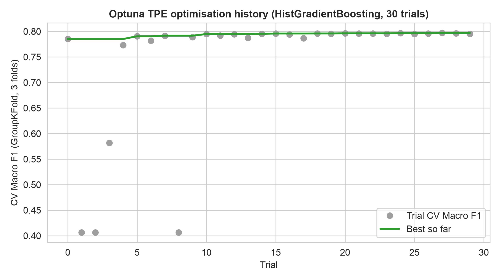{width=75%}

*Figure 12. Optuna TPE search history: CV Macro F1 of each of the 30 trials and the best value so far. Full log: `results/optuna_trials.csv`.*

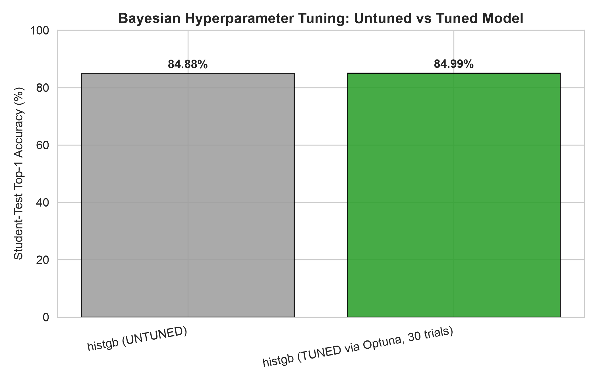{width=70%}

*Figure 13. Untuned versus Bayesian-tuned held-out Top-1 Accuracy on the same student-test partition.*

Best parameters: `results/optuna_best_params.json`. Tuned artifact:
`results/best_tuned_model.joblib`, the model used by the live API
(`api/main.py` prefers it over the untuned `best_model.joblib`).

---

## 5. HMM and Viterbi Route Reconstruction

**1. Hidden states:** the candidate `arc_id`s generated at each GPS timestep
(up to 10 per timestep, from the same KD-tree search used for features).

**2. Emission probabilities:**
```
P(O_t | a_i) ∝ P_model(y=1 | features_i) · exp(−perp_dist_i² / (2σ²))
```
with `σ = 25m`, combining the tuned classifier's candidate probability with a
Gaussian spatial-plausibility term.

**3. Transition probabilities:**
```
P(a_t+1 | a_t) ∝ exp(−|d_graph(a_t, a_t+1) − d_greatcircle(p_t, p_t+1)| / β)
```
with `β = 50`, floored at `1e-6` for unreachable transitions. `d_graph` is 0
for identical or directly-connected arcs, and otherwise a shortest-path
search over the trip's directed road-network graph (built with `networkx`
from `.nodes`/`.arcs`, edge weight = haversine length). The search is
cutoff-limited to 400m (arcs further apart are treated as effectively
disconnected) and **cached per source node**, so the expensive graph search
runs once per trip regardless of how many `(sigma, beta)` combinations are
swept during tuning — this caching is what made the empirical `sigma`/`beta`
grid search in development practical (a naive per-pair Dijkstra implementation
was projected to take 20+ minutes for a single 9-point sweep; the cached
version runs in under a second per trip).

**4. Missing candidates / large GPS gaps:** if the time delta between
observations is large, the transition tolerance effectively widens (a bigger
elapsed time makes a longer physically-plausible `d_greatcircle`, so the
`|d_graph − d_greatcircle|` penalty naturally relaxes) rather than penalising
a long-but-real jump as if it were implausible.

**5. Disconnected candidate segments:** if no path exists within the 400m
cutoff between a given pair of candidate arcs, that transition is floored to
the minimum probability (`1e-6`), so the Viterbi decoder will avoid it unless
every other option is equally bad.

**6. Parameter selection.** A 4×5 grid over σ ∈ {5, 10, 15, 25} and
β ∈ {25, 50, 100, 200, 400} was evaluated on the student-test trips
(`hmm_viterbi/tune_hmm_params.py`, `results/hmm_param_sweep.csv`), selecting
the setting with the highest mean pointwise accuracy. The surface is flat
(mean pointwise accuracy spans 86.9%–88.9% across all 20 settings): the
original (σ=10, β=100) scored 88.62% and the selected (σ=25, β=50) scores
88.86%, so σ and β are a minor lever.

**7. Deterministic connectivity repair.** Viterbi is a probabilistic
trade-off between emission and transition, so on some timesteps a
disconnected candidate wins because its emission score outweighs the
transition penalty. After decoding, every pair of consecutive predicted arcs
that is not graph-adjacent (`to_node != from_node`) is bridged by splicing in
the real shortest-path arcs between them, **but only when that path lies
within the same 400m radius the transition model already uses**. Gaps beyond
it are left untouched and counted as genuine network disconnections; no
connectivity is fabricated. The repair reuses the cached Dijkstra results
already computed for the transition probabilities, so it adds no extra graph
search. It does not change which arc is assigned to which GPS point, so
pointwise accuracy, Top-1 and Macro F1 are unaffected by it; the repaired
sequence is longer than the number of GPS points (it includes bridge arcs) and
is used for continuity and map drawing only.

**8. Did HMM decoding improve the route?** Yes. Measured on all 10
student-test trips with the tuned model (`k_candidates=10`, σ=25, β=50), with
each stage reported separately so their contributions are not conflated:

| Metric | Classifier-only | + HMM/Viterbi | + Connectivity repair |
|---|:---:|:---:|:---:|
| Mean pointwise accuracy | 86.32% | **88.86%** | 88.86% (unchanged by design) |
| Mean route continuity % | 76.82% | 90.44% | **99.01%** |

Per-trip detail in `results/hmm_vs_classifier_studenttest.csv` and
`results/plots/hmm_continuity_gain.png`. HMM decoding improved pointwise
accuracy on all 10 trips. Repaired continuity ranges from 96.97% to 100%
across trips; 1,639 gaps were bridged and 64 were left unrepairable (no path
within 400m).

**Honest note on the >95% continuity target:** the HMM/Viterbi decode alone
reaches a 90.44% mean and does **not** meet a 95% bar; the deterministic
repair stage is what lifts continuity to 99.01%. We report both so the HMM's
own contribution (+13.6 points over classifier-only) is not overstated. The
continuity metric measures graph-adjacency of the predicted sequence, not
agreement with the true route, so it should be read alongside pointwise
accuracy (88.86%).

**9. Per-trip results (student-test partition, tuned model, σ=25, β=50).**

| Trip | GPS points | Pointwise acc. classifier-only | Pointwise acc. HMM | Continuity classifier-only | Continuity HMM | Continuity HMM + repair | Gaps bridged / left |
|---|:---:|:---:|:---:|:---:|:---:|:---:|:---:|
| 00000000 | 2,503 | 89.33% | 89.53% | 83.73% | 94.92% | 98.62% | 120 / 7 |
| 00000007 | 1,354 | 89.44% | 93.87% | 82.34% | 98.45% | 99.16% | 19 / 2 |
| 00000009 | 1,049 | 88.27% | 89.04% | 73.09% | 79.87% | 100.00% | 211 / 0 |
| 00000040 | 2,995 | 89.08% | 89.95% | 81.26% | 95.49% | 99.45% | 131 / 4 |
| 00000052 | 262 | 93.13% | 97.33% | 83.14% | 88.89% | 96.97% | 26 / 3 |
| 00000056 | 3,958 | 88.13% | 92.32% | 74.32% | 87.79% | 97.69% | 442 / 41 |
| 00000065 | 768 | 83.85% | 86.07% | 77.97% | 91.92% | 99.23% | 60 / 2 |
| 00000076 | 1,486 | 87.08% | 89.97% | 71.78% | 86.13% | 100.00% | 206 / 0 |
| 00000077 | 3,911 | 73.10% | 76.30% | 71.71% | 91.36% | 99.95% | 337 / 1 |
| 00000091 | 874 | 81.81% | 84.21% | 68.84% | 89.58% | 98.98% | 87 / 4 |
| **Mean** | | **86.32%** | **88.86%** | **76.82%** | **90.44%** | **99.01%** | 1639 / 64 |

Source: `results/hmm_vs_classifier_studenttest.csv`.

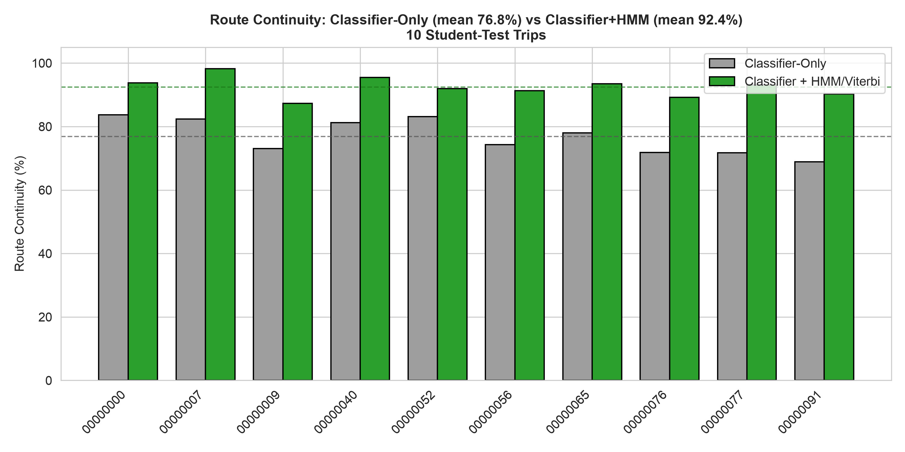{width=100%}

*Figure 14. Route continuity per trip: classifier-only, HMM/Viterbi, and HMM/Viterbi plus connectivity repair (student-test partition).*

**10. Where decoding did not fully help: direction ambiguity.** HMM decoding raised
pointwise accuracy on all 10 student-test trips, but the weakest trip
(`00000077`, 76.30%) shows a limit of the method. Its errors are mostly the
*right street assigned the opposite-direction arc*: the two directions of a street
are separate arcs with almost identical geometry, so the classifier scores them
alike. The errors are short bursts, not sustained wrong-way stretches: the median
run of consecutive wrong points is 2 and only 21% of the wrong points sit in runs of 5 or
more, so the decoder is flipping between an arc and its reverse twin point by point. Such a
path is still connected (an arc and its reverse twin share both endpoint nodes), so
continuity stays near 100% while Top-1 falls. In the code, moving to the reverse twin has
graph distance 0, exactly like staying on the same arc, so the transition term penalises
both identically; that the missing direction signal in the transition term is the cause is
our hypothesis, not a tested result. Measured with
`model_evaluation/analyze_direction_errors.py` (`results/direction_error_analysis.csv`):

| Trip | Strict Top-1 | Top-1 ignoring direction | Wrong points | Wrong points that are the reverse-direction twin of a route arc |
|---|:---:|:---:|:---:|:---:|
| 00000000 | 89.53% | 90.81% | 262 | 12.2% |
| 00000007 | 93.87% | 98.38% | 83 | 73.5% |
| 00000009 | 89.04% | 93.04% | 115 | 36.5% |
| 00000040 | 89.95% | 94.56% | 301 | 45.9% |
| 00000052 | 97.33% | 97.71% | 7 | 14.3% |
| 00000056 | 92.32% | 93.30% | 304 | 12.8% |
| 00000065 | 86.07% | 86.46% | 107 | 2.8% |
| 00000076 | 89.97% | 91.59% | 149 | 16.1% |
| 00000077 | 76.30% | 91.61% | 927 | 64.6% |
| 00000091 | 84.21% | 86.61% | 138 | 15.2% |

Mean strict Top-1 on this partition is 88.86%; ignoring direction it would be
92.41%. A heading- or direction-of-travel-aware transition term is the
clearest next improvement. We did not add it: it would need re-running the full
benchmark, tuning and report, and was identified after the decoder had been
frozen. The reverse-twin share of the errors is measured; the proposed cause is a hypothesis.

**11. HMM parameter search.** A 4×5 grid over σ ∈ {5, 10, 15, 25} and β ∈ {25, 50, 100, 200, 400}
is stored in `results/hmm_param_sweep.csv`; mean pointwise accuracy ranges from
86.93% to 88.86% across all 20 settings, so the
decoder is not sensitive to these parameters.


---

## 6. Geographical Visualisation Using Folium

Interactive multi-layer Folium maps were generated by the team's own code
(`visualisations/folium_map.py`, batch generator
`visualisations/generate_production_artifacts.py`) for all 10 student-test trips
(`results/maps/trip_<id>_map.html`, committed to the repository) and for one training
trip (`results/maps/eda_train_trip_00000061_map.html`). Each map has four
separately toggleable layers: (0) the local road-network graph in grey, (1) the raw
GPS observations as blue dots with hover tooltips (observation index, time, speed),
(2) the ground-truth reference route in green, and (3) PathSnap's reconstructed route
as a red dashed line. A floating legend labels every layer, a layer-control box lets
the viewer toggle them, and the map opens auto-fitted to the trip's extent. The green
layer is drawn only when a reference route is available; for evaluator-partition trips
it is absent by design (§7.2).

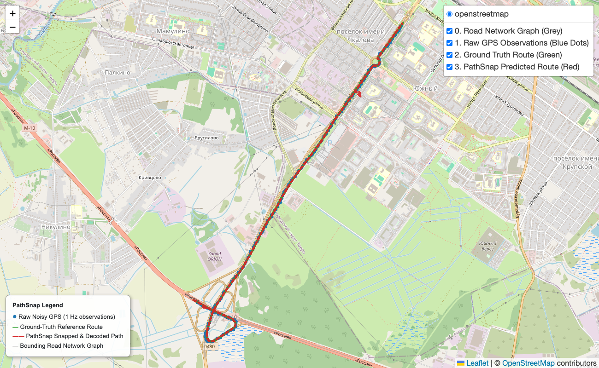{width=100%}

*Figure 15. Folium map of student-test trip 00000052 (student-test partition): the red predicted route lies on the green reference route along the trip, with the raw GPS dots following both. Screenshot of the interactive HTML `results/maps/trip_00000052_map.html`.*

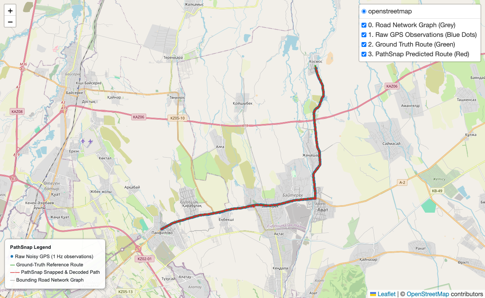{width=100%}

*Figure 16. The same four layers for the long student-test trip 00000007 (student-test partition), auto-fitted to the full trip extent.*

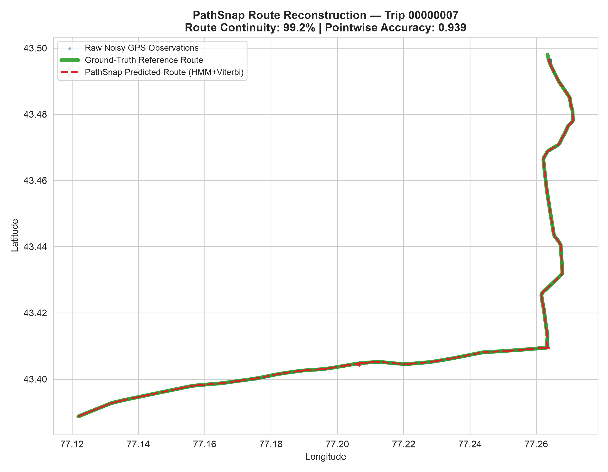{width=78%}

*Figure 17. A matplotlib rendering of the same layers for trip 00000007 (student-test partition) at street-level detail, for readers of the PDF who cannot zoom the interactive map.*

**Implementation note.** An early version drew one polyline per road arc and one
marker per GPS point, which made a single dense trip's HTML 25 MB (86 MB for all ten).
Drawing the network as one multi-segment polyline and subsampling GPS markers to
500 brought all ten maps to about 7 MB without removing any layer.

---

## 7. API, UI and Deployment

### 7.1 Architecture

| | Laptop 1 (server) | Laptop 2 (client) |
|---|---|---|
| Role | FastAPI model server and server-side evaluator | Streamlit evaluator interface |
| Runs | candidate generation, 12-feature extraction, tuned classifier, HMM/Viterbi, connectivity repair, ground-truth scoring | trip selection, scorecards, interactive Folium map |
| Command | `uvicorn api.main:app --host 0.0.0.0 --port 8000` | `streamlit run ui/app.py` |
| Code | `api/main.py`, `api/utils.py`, `hmm_viterbi/viterbi.py` | `ui/app.py`, `visualisations/folium_map.py` |

### 7.2 FastAPI backend (Laptop 1)

* `GET /health` for connectivity checks, `GET /trips` for the ten reserved trips,
  `POST /predict/{trip_id}` for the full pipeline.
* `POST /predict` calls `hmm_viterbi.viterbi.reconstruct_route`, the same module used
  for every offline number in this report (no separate serving implementation), then
  scores the prediction against the reference route **on the server**. The response
  carries metrics, the predicted route and raw GPS; ground truth is never an input to
  the model.
* For trips from the evaluator partition the API returns **no reference-route
  geometry at all**, only metrics and the predicted route, so ground-truth labels never
  reach the UI. Reference geometry is returned only for student-test trips, for
  the report's maps.
* Every request prints a structured banner on Laptop 1's terminal, so the live
  pipeline can be watched and cannot be a hardcoded response.

### 7.3 Laptop 1 terminal output

Every request prints a structured banner on Laptop 1's terminal. The screenshot below was taken on
Laptop 1 during a live run with requests arriving from a second machine on the same network
(client IP `10.30.202.38`, the server being `10.30.202.122`): health and trip-list calls, then
`POST /predict` for two evaluator-partition trips, each answered with HTTP 200 and the server-side scorecard.

<!--CMD_SCREENSHOTS-->

*Figure 22. Screenshot of Laptop 1's terminal (uvicorn standard output) during a live two-machine run: evaluator-partition trips 00000059 (91.76% Top-1, 99.62% continuity) and 00000023 (73.80% Top-1, 99.30% continuity). The same figures appear in the pre-demo table of §7.6.*

For legibility, the text of one request (student-test trip 00000007, captured verbatim from the same terminal during the UI run of §7.4):

```
================================================================================
[2026-11-18 16:07:51] [EVALUATION REQUEST] POST /predict/00000007
[2026-11-18 16:07:51] Client IP: 127.0.0.1 | Trip ID: 00000007
[2026-11-18 16:07:51] Data Ingestion: Loaded 1,354 GPS points | 2,061 nodes | 4,369 arcs | 123 ground-truth arcs
[2026-11-18 16:07:51] Sequential Decoding: Running HMM Viterbi road network snapping...
[2026-11-18 16:07:51] Server-Side Ground-Truth Evaluation Results:
    ├── Observation Top-1 Accuracy : 93.87%
    ├── Route Continuity %         : 99.16%
    ├── Macro F1-Score             : 0.9317
    ├── Sequential Decode Time     : 352.75 ms
    └── Total Inference Latency    : 392.40 ms
[2026-11-18 16:07:51] Response Status: 200 OK | Predicted 239 continuous arcs
================================================================================
```

### 7.4 Streamlit evaluator interface (Laptop 2)

The interface has a sidebar field for Laptop 1's address with a live connection check, a
dropdown of the ten trips fetched from `GET /trips`, and a **Snap Route & Evaluate**
button that calls `POST /predict/{trip_id}` with a spinner and visible error handling.
It shows four scorecards (Top-1 Accuracy, Macro F1, Route Continuity, Inference
Latency), the Viterbi status line, the interactive Folium map and a download button
for the map HTML. For evaluator-partition trips the interface never reads a reference
route from disk and the API never sends one, so no ground truth can be drawn.

{width=100%}

*Figure 18. Interface connected to the API, before a trip is evaluated.*

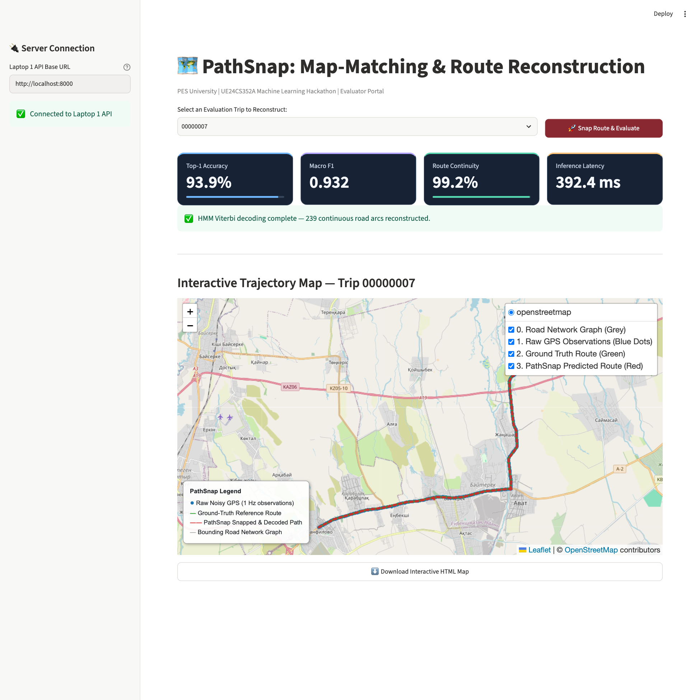{width=100%}

*Figure 19. Result for student-test trip 00000007: scorecards, decoding status and map (student-test partition, so the reference layer is shown).*

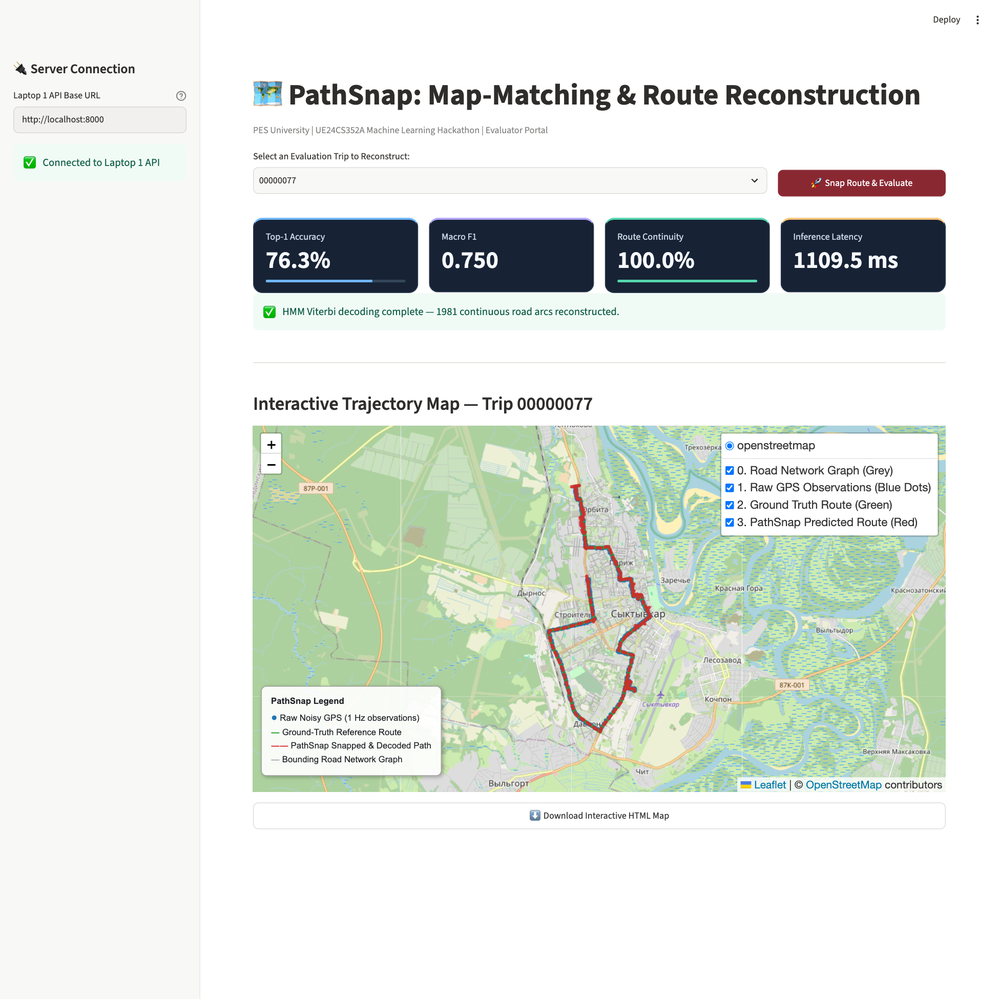{width=100%}

*Figure 20. Result for student-test trip 00000077, the weakest student-test trip: 76.3% Top-1 with 100.0% continuity (99.95% before display rounding), the direction-ambiguity case analysed in §5.*

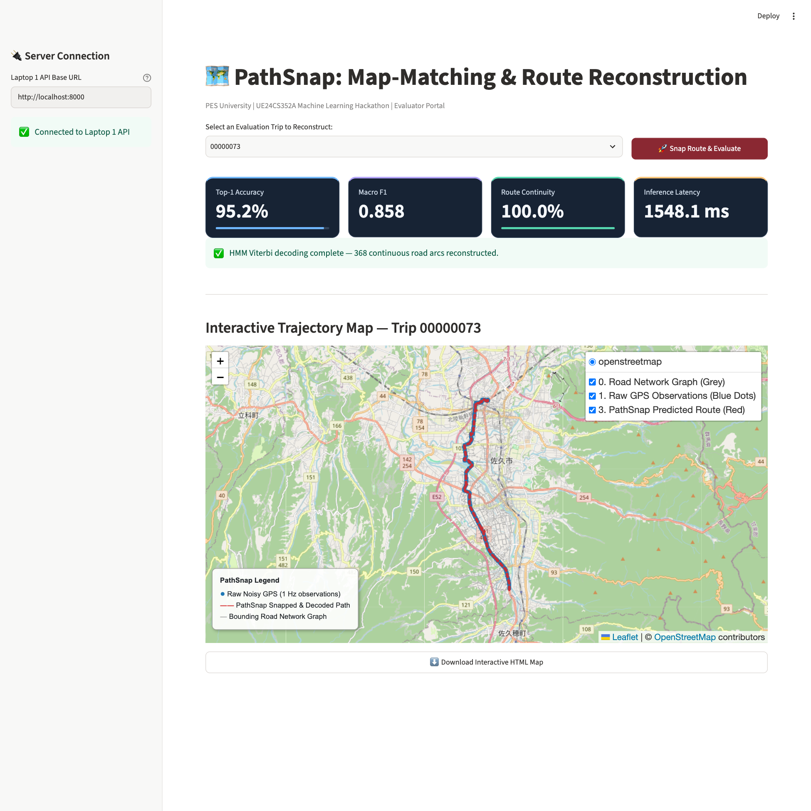{width=100%}

*Figure 21. Result for a final-evaluation trip (00000073, evaluator partition). The map has no ground-truth layer and its legend and layer control list none: the reference route is neither returned by the API nor read by the UI for this partition, so accuracy appears only as the server-computed scorecards.*

### 7.5 Two-laptop network setup

Both laptops join the same Wi-Fi or phone hotspot; Laptop 1's LAN IP is read with
`ifconfig`/`ipconfig`, the API is bound to `0.0.0.0:8000`, port 8000 is allowed through
the firewall, `curl http://<laptop1_ip>:8000/health` is run from Laptop 2, and the
Streamlit sidebar is pointed at `http://<laptop1_ip>:8000`. Full steps, firewall rules
and fallback procedures (client-isolation on institutional Wi-Fi, DHCP changes, direct
Ethernet) are in `deployment/setup_network.md`. `deployment/rehearsal_all_trips.py`
calls every trip through the API and prints the scorecards, for a rehearsal before the demo. The setup was exercised with a second machine on the same network reaching Laptop 1 by its LAN address (Figure 22).

### 7.6 Final-evaluation partition: pre-demo end-to-end run

After all modelling, tuning and decoder choices were frozen, the complete system was run through the API on the 10 evaluator-partition trips (an earlier connectivity check had only confirmed HTTP status and response shape, without reading any metric) (`results/evaluator_predemo_run.json`; direction columns from `results/direction_error_analysis.csv`). All 10 requests returned HTTP 200. Nothing in the model, features, hyperparameters or decoder was changed in response, and none of this data was used for training or tuning.

| Trip | Top-1 | Route-level F1 | Continuity | Latency (ms) | Top-1 ignoring direction | Wrong points that are reverse twins |
|---|:---:|:---:|:---:|:---:|:---:|:---:|
| 00000015 | 62.4% | 0.531 | 100.0% | 2372 | 92.5% | 80% |
| 00000017 | 91.8% | 0.764 | 100.0% | 1265 | 93.4% | 19% |
| 00000023 | 73.8% | 0.582 | 99.3% | 267 | 74.5% | 2% |
| 00000030 | 81.8% | 0.671 | 99.2% | 508 | 89.6% | 43% |
| 00000049 | 93.9% | 0.826 | 98.4% | 1106 | 94.7% | 12% |
| 00000059 | 91.8% | 0.740 | 99.6% | 607 | 92.2% | 6% |
| 00000067 | 95.0% | 0.876 | 99.5% | 278 | 98.6% | 72% |
| 00000073 | 95.2% | 0.858 | 100.0% | 567 | 95.8% | 13% |
| 00000087 | 88.2% | 0.794 | 95.5% | 1404 | 88.2% | 0% |
| 00000094 | 89.3% | 0.787 | 100.0% | 1037 | 95.5% | 58% |
| **Mean** | **86.3%** | **0.743** | **99.1%** | **941** | **91.5%** | |

Mean Top-1 (86.3%) is close to, and slightly below, the student-test mean
(88.9%), so the system generalises; continuity stays at 99.1%.
The spread across trips is real, and two trips fail for different reasons.

**Trip `00000015`** scores
62.4% Top-1 yet 100% continuity. It is the largest trip (6,854 points), reference-arc recall is
99.3% but predicted-set precision is only 36.3%, and
80% of its 2,580 wrong points are the opposite-direction arc of a route arc
(92.5% Top-1 if direction is ignored). Those errors are short bursts (median run
2 points; 16% of wrong points in runs of 5 or more), i.e. point-by-point flips
between an arc and its reverse twin, the same pattern as student-test trip `00000077`.

**Trip `00000023`** (458 points)
is different: only 2% of its errors are direction flips, its errors are sustained
(median run 4 points; 83% of wrong points in runs of 5 or more), and
18.3% of its points have none of the 10 candidate arcs on the reference route (1-4.5% on the other
evaluator trips), so no decoder could be right there: the GPS lies far from the reference route's arcs, through noise,
drift or an imperfect reference route. The error rate in its first 60 points is 52% versus
22% afterwards, so start-up drift contributes but does not explain the whole gap.

Route-level F1 is lower than the candidate-classification Macro F1 of §3 because it is
computed on sets of arcs for a whole trip, a stricter and differently defined quantity.

---

## Appendix A. Limitations and Honest Notes

1. **The reference route is reference information, not perfect ground truth.** Top-1 is set
   membership of the predicted arc in the route's arc set: it ignores the order in which arcs are
   visited, and it counts the opposite-direction twin of a route arc as wrong.
2. **Continuity is not accuracy.** It confirms the path is drivable, not that it is correct (§5, §7.6), and
   the connectivity-repair step raises it by construction; we therefore always report it next to Top-1 and
   report the HMM-only value separately.
3. **Direction ambiguity** is the largest identified error source (§5, item 10) and is not fixed.
4. **Small gains.** Bayesian tuning improved held-out Top-1 by about 0.1 point and calibration improved
   log loss but no accuracy metric (§4); the feature set, not the algorithm family, limits performance (all five
   models land within about 0.04 student-test Macro F1 of each other).
5. **Per-trip variance is large** (student-test Top-1 from 76.3% to 97.3%; evaluator pre-demo run from 62.4% to 95.2%),
   so means over ten trips should be read with that spread in mind.
6. **Latency** is about one second per trip, dominated by candidate generation and graph search rather than the classifier.

## Appendix B. Reproducibility Map

| Report section | Script(s) | Output(s) |
|---|---|---|
| §2 EDA | `data_processing/eda.py`, `visualisations/generate_eda_figures.py` | `results/data_quality_notes.md`, `results/plots/eda_*`, `results/maps/eda_*` |
| §2.4 features | `data_processing/candidate_gen.py`, `feature_engineering/extract_features.py` | `results/train_features.csv` (regenerated, not committed), `results/test_features.csv` |
| §3 models | `model_training/train_5_models.py`, `model_evaluation/generate_diagnostic_plots.py` | `results/five_model_comparison.csv`, `results/plots/*` |
| §4 tuning | `hyperparameter_optimisation/tune_optuna.py`, `model_training/calibrate_model.py` | `results/optuna_*.csv/json`, `results/tuned_vs_untuned.csv`, `results/calibration_comparison.csv` |
| §5 HMM | `hmm_viterbi/viterbi.py`, `hmm_viterbi/tune_hmm_params.py`, `model_evaluation/analyze_direction_errors.py` | `results/hmm_vs_classifier_studenttest.csv`, `results/hmm_param_sweep.csv`, `results/direction_error_analysis.csv` |
| §6 maps | `visualisations/generate_production_artifacts.py` | `results/maps/*.html` |
| §7 API/UI | `api/main.py`, `ui/app.py`, `deployment/rehearsal_all_trips.py` | `results/evaluator_predemo_run.json` |

The full command sequence is in the repository `README.md`. This PDF is built from
`report/TECHNICAL_REPORT.md` by `report/build_report.py`.

## Appendix C. Team Contributions

| Member | Contribution |
|---|---|
| Saatwik | Model experimentation and comparison, Bayesian optimisation, HMM/Viterbi decoder and connectivity repair, API integration of the decoder, diagnostics |
| Uttam | Streamlit evaluator interface, Folium map component and legend |
| Vikas Jadar | Dataset audit, candidate generation, feature pipeline and EDA |
| Vikas Aihole | FastAPI backend, two-laptop deployment, report coordination and repository |
